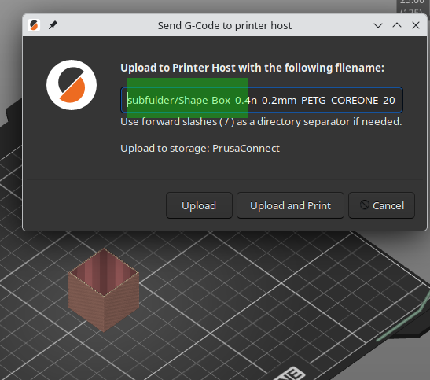
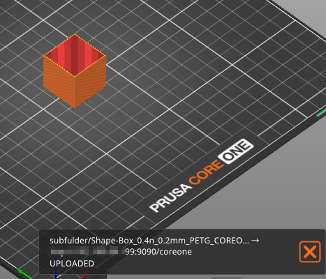
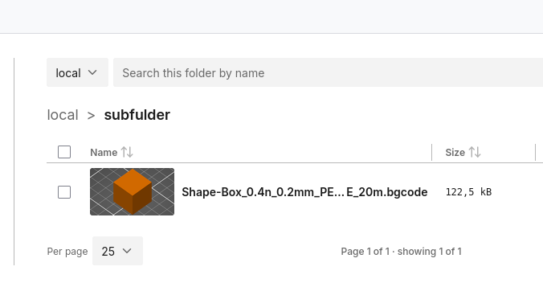
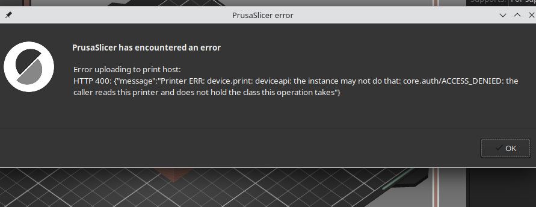
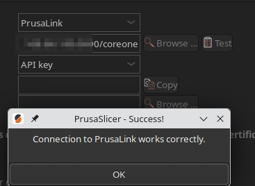

# Prusalinkemu

A Prusa Connect module that emulates PrusaLink.
So it's usable with the PrusaSlicer 2.9.x
For now it's WIP (it works with the dmeo) and has a fixed listening port 9090 
No API Key is required ATM.

## what works?
* upload

 
## what doesn't work at the moment?
* print after upload (it's a prusaconnect access limitation)

## setup instructions in slicer
* HostType: PrusaLink (obviously)
* HostName: http://<ip>:9090/<printername>

The printername is converted to lowercase/slug and then compared to the printers in PrusaConnect.